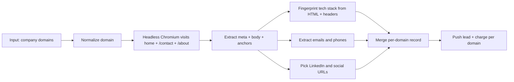

# B2B Lead Enrichment Pipeline: Domain to Company Intel

[](https://apify.com/Turboextract/b2b-lead-enrichment-pipeline)
[](LICENSE)
[](#pricing)

**Feed in a list of company domains. Get back enriched lead records: company name, description, tech stack, LinkedIn, socials, and contact emails.** Built for sales ops, SDRs, and GTM teams who currently pay Clearbit / Apollo per seat.

One domain in, one full lead record out. Pay per domain, not per seat.

**Try it now →** [apify.com/Turboextract/b2b-lead-enrichment-pipeline](https://apify.com/Turboextract/b2b-lead-enrichment-pipeline)

> This repository holds documentation and ready-to-run API examples. The actor itself runs on the Apify platform - no installation needed.

---

## Why this exists

- **Enrichment tools charge per seat.** Clearbit, Apollo and ZoomInfo price for sales teams, not for a one-off list of 300 domains.
- **Company websites already say who they are.** Name, description, socials, contact emails and tech stack are read straight from the homepage, contact and about pages.
- **CRMs need flat records.** One domain in, one consistent lead record out.

---

## Who this is for

- **Sales ops** building ABM lists from a book of target domains
- **SDR teams** enriching inbound signups before outreach
- **Partnership and BD** vetting potential partners at scale
- **Growth marketers** segmenting lists by tech stack or company stage
- **Data engineers** piping domain enrichment into Salesforce / HubSpot

If you currently pay $12,000/year for Clearbit per 50 seats, this replaces the data layer at pennies per domain.

---

## What you get per domain

```json
{
  "domain": "apify.com",
  "companyName": "Apify",
  "description": "The complete API for web scraping & browser automation.",
  "techStack": ["Next.js", "Tailwind CSS", "Segment", "Google Analytics", "Cloudflare"],
  "emails": ["hello@apify.com", "support@apify.com"],
  "phones": ["+1 415 555 0119"],
  "linkedin": "https://www.linkedin.com/company/apifytech",
  "twitter": "https://twitter.com/apify",
  "facebook": null,
  "instagram": null,
  "youtube": "https://www.youtube.com/@ApifyTech",
  "github": "https://github.com/apify",
  "aboutExcerpt": "Apify is the complete platform for web scraping and browser automation...",
  "pagesScraped": ["home", "contact", "about"],
  "enrichedAt": "2026-11-08T12:00:00Z"
}
```

Real output from a verified run: [examples/sample-output.json](examples/sample-output.json).

---

## How it works



Pipeline actors like this charge 6x more per customer action than single-page scrapers because they ship complete, usable output — not raw data a buyer still has to process.

---

## Quick start

### From the Apify Console (no code)

1. Click **Try for free**.
2. Paste domains (one per line).
3. (Optional) Disable contact-page scraping for faster runs.
4. Click **Start**.
5. Download as JSON, CSV, or Excel — or push into your CRM via webhook.

### From the API ([curl](examples/curl.sh))

```bash
curl -X POST "https://api.apify.com/v2/acts/Turboextract~b2b-lead-enrichment-pipeline/runs?token=YOUR_TOKEN" \
  -H "Content-Type: application/json" \
  -d '{
    "domains": ["apify.com", "stripe.com", "linear.app"],
    "scrapeContactPage": true,
    "maxDomains": 100
  }'
```

### From Python ([full example](examples/python.py))

```python
from apify_client import ApifyClient

client = ApifyClient("YOUR_TOKEN")
run = client.actor("Turboextract/b2b-lead-enrichment-pipeline").call(run_input={
    "domains": ["apify.com", "stripe.com"],
})
for lead in client.dataset(run["defaultDatasetId"]).iterate_items():
    print(lead["companyName"], lead["techStack"])
```

### From Node.js ([full example](examples/node.mjs))

```javascript
import { ApifyClient } from 'apify-client';

const client = new ApifyClient({ token: 'YOUR_TOKEN' });
const run = await client.actor('Turboextract/b2b-lead-enrichment-pipeline').call({
    domains: ['apify.com', 'linear.app'],
    scrapeContactPage: true,
});
const { items } = await client.dataset(run.defaultDatasetId).listItems();
console.log(items);
```

---

## Input fields

| Field | Type | Default | Description |
|---|---|---|---|
| `domains` | array | required | Company root domains (http prefix optional) |
| `scrapeContactPage` | boolean | true | Also visit /contact and /about for richer data |
| `maxDomains` | integer | 200 | Safety cap per run |

---

## Pricing

**Pay per domain enriched. No subscriptions.**

| Volume | Price per domain | Total |
|---|---|---|
| Per domain | $0.020 | 100 domains = $2 |
| 1,000 domains | $0.020 | $20 |
| 10,000 domains | $0.020 | $200 |

### How it compares

| Tool | Pricing model | 1,000 enrichments |
|---|---|---|
| **B2B Lead Enrichment Pipeline** | $0.02 per domain | **$20** |
| Clearbit Enrichment | Per-seat subscription | $12,000+/yr |
| Apollo.io | Per-seat subscription | $500+/mo + credits |
| ZoomInfo | Enterprise contract | $15,000+/yr |
| Hunter.io | Credit-based | $0.49 per lookup |

---

## Common use cases

- **ABM list building** — upload 500 target domains, get instant enriched data
- **Inbound signup qualification** — enrich a new-trial domain to route to the right AE
- **Tech-stack segmentation** — filter accounts running Shopify / HubSpot / Stripe for product fit
- **Competitive mapping** — see which prospects use your competitor's tech
- **CRM backfill** — enrich stale account records with current socials and tech

---

## Tips for best results

- Pass root domains (`apify.com`), not subdomains (`blog.apify.com`)
- Keep `scrapeContactPage: true` for the full lead record (3 pages per domain)
- For 1,000+ domains, run in batches of 200 and schedule overnight
- Combine `techStack` with LinkedIn URLs to prioritize ICP-fit accounts

---

## Pairs well with

- **[Global Sanctions Screening](https://apify.com/Turboextract/global-sanctions-screening)** — enrich a company, then screen its name
- **[AI Training Dataset Builder](https://apify.com/Turboextract/ai-training-dataset-builder)** — feed the enriched LinkedIn URL in for deeper company corpus

---

## FAQ

**Does this return personal emails?**
No. Only domain-scoped addresses (info@, hello@, support@) that appear on the public site. For individual contact data, use a person-level enrichment tool.

**How accurate is tech-stack detection?**
Pattern-based — detects ~20 common tools (React, Next, WordPress, Shopify, Stripe, Segment, GA, etc.) from HTML and headers. False negatives on obscure or server-side-only stacks are expected.

**What about sites that block scraping?**
Rate-limited sites are retried with backoff; hard-blocked sites return empty. You aren't charged for domains that return no pages.

**Does it handle SPAs?**
Yes — headless Chromium via Playwright, so Next.js / React / Vue apps render fully before extraction.

**Can I get employee count or revenue?**
Not from the public site alone. Add that via a people-level enrichment source (LinkedIn, Crunchbase).

**Can I run this on a schedule?**
Yes. Apify's scheduler supports any cron expression. Set up weekly re-enrichment of your pipeline.

**Is there a free tier?**
Apify's platform credits cover initial exploration. After that, pay-per-domain only applies to successfully-enriched domains.

---

## SEO keywords

For visitors who arrived here from search: this tool is also referred to as a **company enrichment API**, a **domain to company data**, a **Clearbit alternative**, an **Apollo alternative**, a **website tech stack lookup**, a **lead enrichment tool**, a **B2B data enrichment**, and a **company contact finder**.

---

## Support

- Open an issue on this repo for bug reports - please include your run input
- Actor page on Apify: [apify.com/Turboextract/b2b-lead-enrichment-pipeline](https://apify.com/Turboextract/b2b-lead-enrichment-pipeline)
- Community Discord: [discord.gg/8SrXSCpvgj](https://discord.gg/8SrXSCpvgj) - updates, support and feature requests
- Maintained by [Turboextract](https://apify.com/Turboextract) on the Apify platform

## License

[MIT](LICENSE) - examples and documentation. The actor itself is hosted on Apify under their platform terms.
